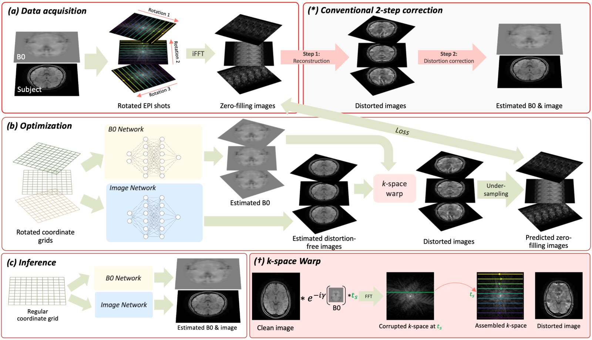

# PINR

Official implementation of **Physics-Informed Implicit Neural Representations for Joint B0 Estimation
and Echo Planar Imaging** (MICCAI 2025).

Echo planar imaging (EPI) is distorted along the phase-encoding direction by B0 inhomogeneity.
PINR estimates the B0 field and the distortion-free image jointly from rotated-view EPI
acquisitions: two implicit neural representations with hash-grid encodings (one for B0, one for the
complex image) are optimised through a differentiable EPI forward model that accrues the B0 phase
along the echo train and assembles the acquired k-space lines of every view. Rotating the
phase-encoding direction between views spreads distortion and aliasing over different axes, which
makes the joint problem well posed. The loss is the multi-coil data-consistency term on the
undersampled k-space of all views plus a smoothness penalty on B0. TOPUP (FSL) applied to
GRAPPA-reconstructed blip-up/down images is the baseline.



## Installation

Requirements: Linux, an NVIDIA GPU, and a CUDA toolkit (`nvcc`) matching your PyTorch build
(needed to compile tiny-cuda-nn).

```bash
conda create -n pinr python=3.10 -y
conda activate pinr
pip install -r requirements.txt
pip install --no-build-isolation git+https://github.com/NVlabs/tiny-cuda-nn/#subdirectory=bindings/torch
```

External tools, only needed for the scripts that call them:

- FSL (`topup` binary) for the baseline `main_topup.py`; set `FSLDIR` if FSL is not under `/usr/local/fsl`.
- BART (`bart ecalib`) for the ESPIRiT-based B0 fitting in `prepare_simulated_data_PD.py`; set
  `TOOLBOX_PATH` to the BART installation directory.

## Quick start (synthetic example, no data required)

```bash
python make_synthetic_example.py --n_angle 3
python main.py --config configs/config_simulated_rot3.yml --subject_id synthetic --slice_idx 0 --R 6
```

The first command takes the bundled brain phantom (`demo/mni152_phantom.npz`: a T2*-like axial
slice of the ICBM 152 template at the skull base and a B0 map from a susceptibility model of the
head, -80 to +140 Hz inside the brain and up to 220 Hz at the skull base, see `demo/README.md`),
adds a smooth phase and coil sensitivities, rotates everything to three views and distorts each
view with the EPI forward model (56 ms readout, displacements up to 12 pixels along the
phase-encoding direction). The second command
reconstructs the slice with PINR (6000 iterations, about 5 minutes on an RTX A6000) and writes
`results/simulated_rot3/synthetic/`:
`reconstructed_data_Slice0.mat` (`img_orig`, `recon`, `b0`) and `results_Slice0.png`
(EPI views, predicted views, B0 and image comparisons). `make_synthetic_example.py` also takes
`--b0_scale`, `--esp_fs` and `--t2star_ms` to make the distortion stronger or to add signal
decay along the echo train; it prints the fold-over indicator |dB0/dPE| * N_y * esp, above 1 the
displacement is no longer invertible and signal piles up.

## Data

The paper simulates rotated-view EPI from distortion-free multi-echo GRE images acquired with EPTI.
That dataset is not distributed. `prepare_simulated_data_PD.py` expects one `.mat` file per subject
with the keys

| key | shape | content |
|---|---|---|
| `im` | (ny, nx, nz) | complex distortion-free images |
| `B0` | (ny, nx, nz) | B0 field in Hz |
| `R2s_rec` | (ny, nx, nz) | R2* map (masked, kept for completeness) |
| `SEs` | (ny, nx, nz, ncoil) | coil sensitivity maps |

and writes, per slice, `simulated_data/multi_angle_rot{N}/{subject}/simulated_data_Slice{k}.mat`
with `img` (distortion-free image), `imgs_epi` (distorted views), `B0`, `csm` (both rotated per
view), `esp` (echo spacing of the fully sampled EPI, s) and `thetas` (view angles, degrees). The
same format is produced by `make_synthetic_example.py`, so any distortion-free image, B0 map and
coil sensitivities can be turned into an input for `main.py` this way (`demo/build_mni_phantom.py`
shows how the bundled phantom and its B0 map were made).

`data/`, `simulated_data/` and `results/` are git-ignored.

## Running the pipeline

```bash
# 1. simulate N rotated views from a subject file (needs BART for the B0 fit)
python prepare_simulated_data_PD.py --data_file data/raw/subject01.mat --n_angle 3 --save_dir simulated_data/multi_angle

# 2. PINR on one slice; --R is the per-view acceleration factor
python main.py --config configs/config_simulated_rot3.yml --subject_id subject01 --slice_idx 130 --R 6

# 3. all subjects and slices listed in the batch script, distributed over the GPUs in gpu_list
python batch_run_rot3_main.py

# 4. TOPUP baseline on the two-view (blip-up/down) simulation: GRAPPA per view, then topup
python main_topup.py --config configs/config_simulated_rot2.yml --subject_id subject01 --R 4

# 5. NRMSE / PSNR / SSIM of the images and mean absolute B0 error, TOPUP vs two- and three-view PINR
python cal_metrics.py
```

The batch scripts use `R = 2 * N` for `N` views, so every experiment sees the same number of
k-space lines as a fully sampled acquisition accelerated by two. Subject identifiers and slice
ranges in `batch_run_rot*.py` and `cal_metrics.py` are placeholders to be edited.

## Configuration

`configs/config_simulated_rot{2,3}.yml` hold the paper settings:

- `data_config`: `data_dir`, `subject_id`, `slice_idx`, `R` (per-view acceleration) and
  `b0_factor` (scale between the B0 network output and Hz).
- `model_config.img` / `model_config.b0`: tiny-cuda-nn hash-grid encoding (16 levels, 2 features per
  level, hash map 2^20, base resolution 16) and MLP widths; the image network has two outputs (real
  and imaginary part), the B0 network one.
- `train_config`: `n_iter`, `lr` (AdamW), `b0_smooth_factor` (B0 total-variation weight, decayed by
  10x every 1000 iterations and switched off for the last 1000) and `out_roi_supression_factor`.
- `log_config.save_dir`: results go to `{save_dir}_rot{N}/{subject}/`.

Command-line flags `--subject_id`, `--slice_idx`, `--R` and `--device` override the config.

## Project structure

```
main.py                        # PINR: joint B0 and image reconstruction of one slice
main_topup.py                  # baseline: GRAPPA + FSL TOPUP on the two-view simulation
prepare_simulated_data_PD.py   # rotated-view EPI simulation from multi-echo GRE data
make_synthetic_example.py      # same simulation on the bundled brain phantom
demo/                          # phantom slice, B0 map and the script that builds them
batch_run_rot2_main.py         # batch drivers over subjects, slices and GPUs
batch_run_rot3_main.py
cal_metrics.py                 # image and B0 metrics
model.py                       # hash-grid encoding + MLP (tiny-cuda-nn)
configs/                       # paper configs and the TOPUP configuration
utils/
├── mri.py                     # EPI forward model, undersampling, centred FFTs
├── image_processing.py        # view rotation, padding
├── b0_fitting.py              # B0 fitting (ESPIRiT via BART, spherical harmonics, polynomial)
└── parser.py                  # YAML config loading
```

## Citation

```bibtex
@inproceedings{huang2025pinr,
  title     = {Physics-Informed Implicit Neural Representations for Joint {B0} Estimation and Echo Planar Imaging},
  author    = {Huang, Wenqi and Wang, Nan and Liao, Congyu and Lin, Yimeng and Gao, Mengze and Rueckert, Daniel and Setsompop, Kawin},
  booktitle = {Medical Image Computing and Computer Assisted Intervention -- MICCAI 2025},
  series    = {Lecture Notes in Computer Science},
  publisher = {Springer},
  year      = {2025}
}
```

## Acknowledgements

The encoding + MLP wrapper in `model.py` follows [multi_contrast_inr](https://github.com/jqmcginnis/multi_contrast_inr).
`configs/b02b0_topup.cnf` is based on FSL's default topup configuration. The demo phantom is derived from
the ICBM 152 2009a template, see [demo/README.md](demo/README.md) for its terms.

## License

MIT, see [LICENSE](LICENSE).
